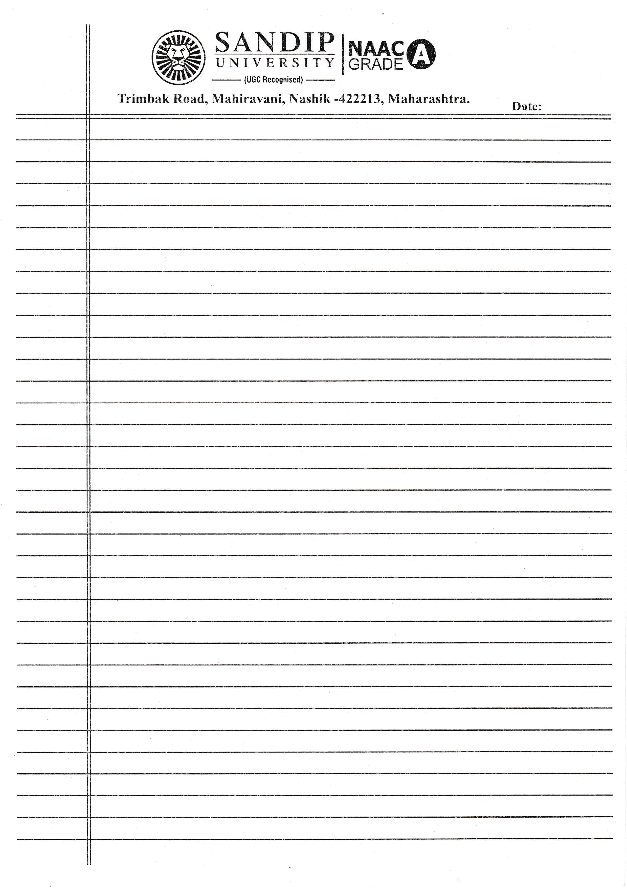

# 🖋️ RuledSheet Studio

<p align="center">
  
</p>

<p align="center">
  <strong>Transform typed Word (.docx) assignments into realistic handwritten notes calibrated directly on physical ruled paper sheets.</strong>
</p>

<p align="center">
  <a href="https://github.com"></a>
  <a href="https://github.com"></a>
  <a href="https://github.com"></a>
  <a href="https://pages.cloudflare.com"></a>
  <a href="https://pdf-lib.js.org"></a>
  <a href="LICENSE"></a>
</p>

---

## 🌟 Overview

**RuledSheet Studio** is an advanced, client-side web application designed to solve a universal student challenge: converting typed Word documents, questions, and assignments into **indistinguishable, realistic handwritten pages** aligned with mathematical precision on **physical university ruled notebook sheets**.

Pre-calibrated for **standard A4 pre-printed ruled sheets** (33 ruled lines, double vertical red index line, top header margins) with complete support for custom paper templates.

---

## ✨ Key Features

- 📏 **Physical Ruled Paper Alignment:**
  Calculates exact physical millimeter baselines for pre-printed ruled sheets so every line of handwritten text rests directly on the ruling without floating or sinking.
- ✍️ **Ultra-Realistic Handwriting Fonts:**
  Curated cursive scripts (`Bad Script`, `Caveat`, `Marck Script`, etc.) with organic character baseline micro-jitter, subtle ink bleeds, and organic letter spacing.
- 📑 **Smart Q&A Parser & Auto-Coloring:**
  Automatically identifies questions and answers from imported Microsoft Word (`.docx`) files:
  - **Questions / Topics:** Jet black ballpoint ink (`#111827`)
  - **Answers / Explanations:** Deep royal fountain pen blue ink (`#1e3a8a`)
- 🏷️ **Left Margin Prefix Placement:**
  Prefixes such as `Q.1`, `Q.2`, and `Ans.` sit in the left margin column beside the double vertical index rule, sharing exact ruled baselines with body text.
- ⌨️ **Word-Style Line Editing & Font Resizing:**
  - Pressing `Enter` creates a new line on the next ruled row.
  - Selected-line font size controls (`[-] 14pt [+]`) let you emphasize headings or shrink long answers dynamically.
- 📄 **Dual Vector PDF Export Engine:**
  1. **Sheet Preview PDF:** Renders handwritten notes directly over the high-resolution scanned sheet background (ideal for digital submissions, Google Classroom, and LMS uploads).
  2. **Text-Only Print-Ready PDF:** Strips background rulings, exporting only the handwritten vector text at precise physical millimeter coordinates. Feed your actual university ruled paper into the printer for authentic handwritten sheets!
- 🖨️ **Printer Calibration & Baseline Nudge:**
  Interactive baseline adjustment tool (`-1.0mm` to `+1.0mm`) with 1-page test sheet export to compensate for individual printer feed-roller tolerances.
- 📱 **Fully Mobile & Touch Optimized:**
  Responsive segmented mode switcher (`[ Paper View ]` / `[ Controls & Text ]`), auto-zoom paper scaling, touch-friendly line selection popovers, and fullscreen calibration dialog.
- 🔒 **100% Client-Side & Private:**
  All document parsing (`mammoth.js`) and PDF vector compilation (`pdf-lib`) execute entirely inside your browser. No files or data ever leave your machine.

---

## 🛠️ Local Development Setup

### Prerequisites
- [Node.js](https://nodejs.org/) v18.0.0 or higher
- `npm` v9.0.0 or higher

### Steps

```bash
# 1. Clone the repository
git clone https://github.com/<your-username>/ruledsheet-studio.git
cd ruledsheet-studio

# 2. Install dependencies
npm install

# 3. Start local development server
npm run dev

# 4. Open in browser
# http://localhost:5173
```

### Production Build & Preview

```bash
# Compile TypeScript and bundle via Vite
npm run build

# Preview production build locally
npm run preview
```

---

## 🖨️ Critical Printing Guide (Physical Ruled Sheets)

When printing the **Text-Only PDF** onto physical university ruled notebook paper:

> [!IMPORTANT]
> **Printer Scale Setting:**
> Always set your printer dialog to **"Actual Size"** or **100% Scale**.
> **NEVER** select *"Fit to Page"* or *"Fit to Printable Area"*, as those settings shrink the document by 4% to 6%, misaligning all text baselines from the physical ruling.

| Setting | Required Value | Rationale |
| :--- | :--- | :--- |
| **Paper Size** | **A4** (210 × 297 mm) | Standard Indian university sheet dimensions |
| **Scale** | **Actual Size (100%)** | Preserves 1:1 millimeter physical ruling layout |
| **Two-Sided** | Optional | Feed ruled sheets in uniform orientation |
| **Paper Tray Guides**| Snug against paper edge | Prevents tray skew during feed |

---

## 📁 Project Architecture

```
ruledsheet-studio/
├── public/
│   ├── default_template.jpg    # High-resolution scanned university ruled sheet
│   └── fonts/                  # Embedded handwriting TrueType fonts for PDF-Lib
├── src/
│   ├── components/
│   │   ├── DocumentStep.tsx    # Word (.docx) upload, drag-and-drop & parsing
│   │   ├── ExportStep.tsx      # Dual PDF generation, baseline nudge & print instructions
│   │   ├── LineCalibrationModal.tsx # Interactive ruled line tuning & auto-detection
│   │   ├── PreviewStep.tsx     # Full interactive studio, SVG renderer & mobile view
│   │   ├── StepIndicator.tsx   # Responsive progress workflow navbar
│   │   └── TemplateStep.tsx    # Ruled paper selection & custom image loader
│   ├── types/
│   │   └── index.ts            # TypeScript interfaces for templates, blocks & settings
│   ├── utils/
│   │   ├── defaultTemplate.ts  # Standard 33-line physical calibration data
│   │   ├── docxParser.ts       # Mammoth.js DOCX text extractor & Q&A classifier
│   │   ├── layoutEngine.ts     # Multi-page layout engine & line-wrapping math
│   │   ├── lineDetector.ts     # HTML5 Canvas image edge detection algorithm
│   │   └── pdfGenerator.ts     # High-resolution vector PDF compiler (pdf-lib)
│   ├── App.tsx                 # Root application controller & responsive state
│   ├── index.css               # Modern design system & mobile media queries
│   └── main.tsx                # React root mount
├── index.html                  # SEO meta tags, OpenGraph, JSON-LD schema & fonts
├── package.json
├── tsconfig.json
├── vite.config.ts
└── wrangler.jsonc              # Cloudflare Workers Static Assets configuration
```

---

## 🧩 Tech Stack

- **Framework:** [React 18](https://react.dev/) + [TypeScript](https://www.typescriptlang.org/)
- **Build Tool:** [Vite 5](https://vitejs.dev/)
- **PDF Vector Engine:** [pdf-lib](https://pdf-lib.js.org/) & [@pdf-lib/fontkit](https://github.com/Hopding/fontkit)
- **Document Processing:** [mammoth.js](https://github.com/mwilliamson/mammoth.js) (DOCX to structured text)
- **Icons:** [Lucide React](https://lucide.dev/)
- **Delight:** [canvas-confetti](https://www.npmjs.com/package/canvas-confetti)
- **Deployment:** [Cloudflare Pages](https://pages.cloudflare.com/)

---

## 📄 License

This project is open-source and available under the [MIT License](LICENSE).
